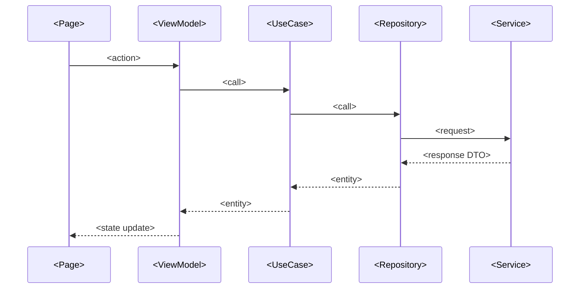

<!--
Template for docs/ARCHITECTURE.md. Replace every <placeholder>. Remove sections that do not apply. Remove this comment.
-->
# Architecture

## Overview

<2–4 sentences: architecture pattern, UI toolkit, reactive/async stack, how modules relate.>

## Module Map

| Module | Purpose | Depends on | Doc |
| --- | --- | --- | --- |
| `<Module>` | <one line> | `<Module>`, `<Module>` | [<module>.md](modules/<module>.md) |

```mermaid
graph TD
    App --> <Feature>
    <Feature> --> Core
```

## Layers

| Layer | Owns | Must not | Base types |
| --- | --- | --- | --- |
| Presentation | <views, view models> | <call services directly> | `<BaseViewModel>` |
| Domain | <use cases> | <import UI frameworks> | `<UseCase protocol>` |
| Data | <repositories, services, DTOs> | <hold UI state> | `<BaseService>` |

## Data Flow

<One representative request, from user action to UI update, with real type names.>



## Cross-Cutting Concerns

### Dependency Injection
<Framework, where registration lives (path), how a new feature registers.>

### Navigation
<Pattern, key types and paths, how deep links enter.>

### Networking
<Client, base configuration path, interceptors/plugins, error mapping.>

### Persistence
<What is stored where: Keychain/EncryptedSharedPreferences, UserDefaults/DataStore, database.>

### Auth & Session
<How tokens are stored and refreshed, what happens on 401.>

### Analytics & Logging
<SDKs, wrapper types, where events are defined.>

### Feature Flags & Remote Config
<Source, wrapper type, path.>

## Environments

| Configuration / Flavor | Backend | Notes |
| --- | --- | --- |
| `<name>` | <env name, no URL> | <notes> |

## Deviations

- <Where this project differs from the EDTS guidelines, stated as fact, with path.>
