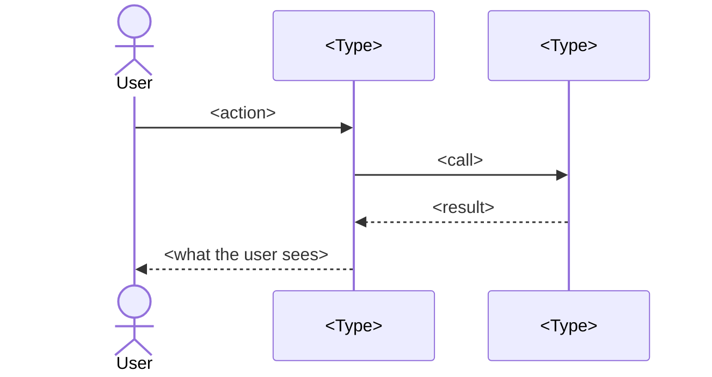

<!--
Template for docs/flows/<flow>.md. Every arrow must match a call found in code. Remove this comment.
-->
# <Flow Name>

<One sentence: what triggers this flow and what it achieves.>

**Modules involved:** `<Module>`, `<Module>`

## Happy Path

1. <Step with type and file path.>
2. <Step.>

## Failure Paths

| Failure | Detected in | What happens |
| --- | --- | --- |
| <e.g. expired token> | `<Type.method>` | <e.g. refresh once, then log out> |

## Gotchas

- <Ordering constraints, race conditions, platform quirks.>
