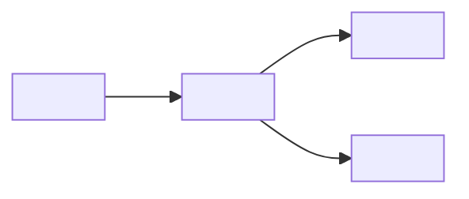

<!--
Option: flow/journey — a user journey that is mostly screens and choices (onboarding, registration, first scan).
Writes to docs/flows/journey/<flow>.md. Every step must match a screen and code path you opened. Remove this comment.
-->
# <Journey Name>

<One sentence: who starts this journey, from where, and what they end with.>

**Entry points:** <app launch / tab / deep link / push> · **Modules:** [<module>](../../modules/<variant>/<module>.md)

## Map

## Steps

| # | Screen | User does | App does | Code |
| --- | --- | --- | --- | --- |
| 1 | <Screen> | <tap / type / scan> | <validates, calls API, saves> | `<Type.method>` |

## Branches & Exits

| Condition | Goes to | Code |
| --- | --- | --- |
| <e.g. account already exists> | <Screen / message> | `<Type.method>` |

## Gotchas

- <Steps that can be skipped, back-navigation traps, data kept between steps.>
