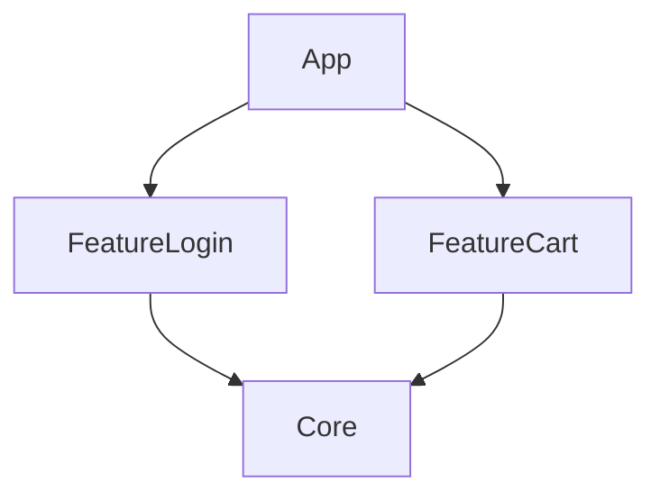

# Architecture Doc

`docs/ARCHITECTURE.md` explains how the app is put together. Use [assets/ARCHITECTURE.template.md](../assets/ARCHITECTURE.template.md).

## What to Discover

Open these before writing. Do not describe a layer you have not seen code for.

### iOS

| Topic | Where to look |
| --- | --- |
| Entry point | `@main` type, `AppDelegate`, `SceneDelegate`, `SetupApplication.swift` |
| Modules | `Modules/*/Package.swift` (name, dependencies), or groups under the app target |
| DI | `DI/DI.swift`, `*Assembly.swift`, `*Injection.swift` |
| Navigation | `Navigator`, `AppNavigator`, `*Navigator.swift`, coordinators if any |
| Networking | `*Service.swift`, API client, endpoint enums, interceptors |
| Persistence | Keychain wrappers, `UserDefaults` wrappers, Core Data / SwiftData / Realm |
| Reactive stack | Combine (`AnyPublisher`) vs RxSwift (`Observable`) — note if both exist |
| Third-party SDKs | `Package.resolved`, `Podfile.lock` — only the ones with app-wide impact |

### Android

| Topic | Where to look |
| --- | --- |
| Entry point | `Application` subclass, launcher `Activity` in `AndroidManifest.xml` |
| Modules | `settings.gradle(.kts)` includes, each module's `build.gradle(.kts)` dependencies |
| DI | `@HiltAndroidApp`, `@Module` classes, or Koin `module { }` blocks |
| Navigation | `NavHost`, `res/navigation/*.xml`, deep link declarations |
| Networking | Retrofit interfaces, OkHttp interceptors, Ktor clients |
| Persistence | Room `@Database`, DataStore, EncryptedSharedPreferences |
| Async stack | Coroutines/Flow vs RxJava — note if both exist |
| Build variants | `buildTypes`, `productFlavors` |

## Required Content

1. **Overview** — the pattern in 2–4 sentences (e.g. "Clean Architecture with MVVM. Feature modules depend on Core. Combine end-to-end.").
2. **Module map** — a table of every module with one-line purpose, plus a mermaid dependency graph built from the actual build files.
3. **Layers** — what each layer owns and what it must not do. Name the base classes (`BaseViewModel`, etc.).
4. **Data flow** — one representative request traced from UI to network and back, with real type names. A mermaid sequence diagram is preferred.
5. **Cross-cutting concerns** — DI, navigation, networking, persistence, auth/session, analytics, logging, feature flags/remote config. One short subsection each, with file paths.
6. **Environments** — build configurations/flavors and how they map to backends (names only).
7. **Deviations** — places where the code does not follow the expected EDTS architecture. State them as facts, not criticism.

## Diagrams

- Use mermaid in fenced ` ```mermaid ` blocks. It renders on GitHub/GitLab and stays readable as text for agents.
- Build the module graph from dependency declarations, not from folder names.
- Keep graphs under ~25 nodes. For bigger projects, show Core + feature groups and link to module docs for the rest.



## Avoid

- Repeating the EDTS guideline rules. Link to the skill instead and document only how this project applies or deviates.
- Listing every class. The module docs cover detail.
- Describing intended architecture that the code does not implement.
